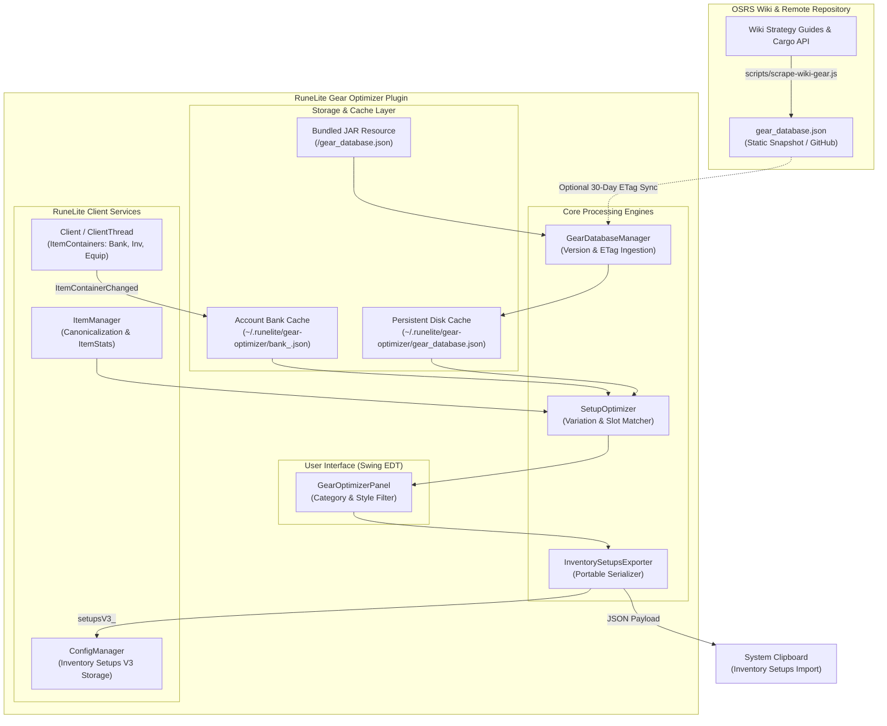
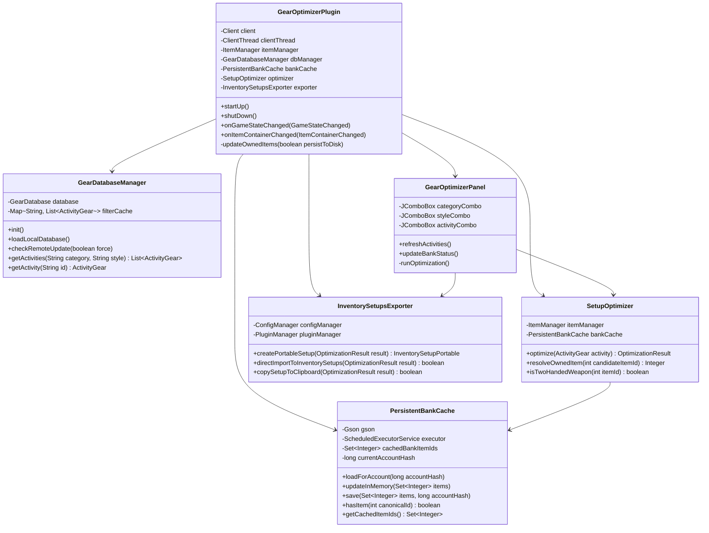
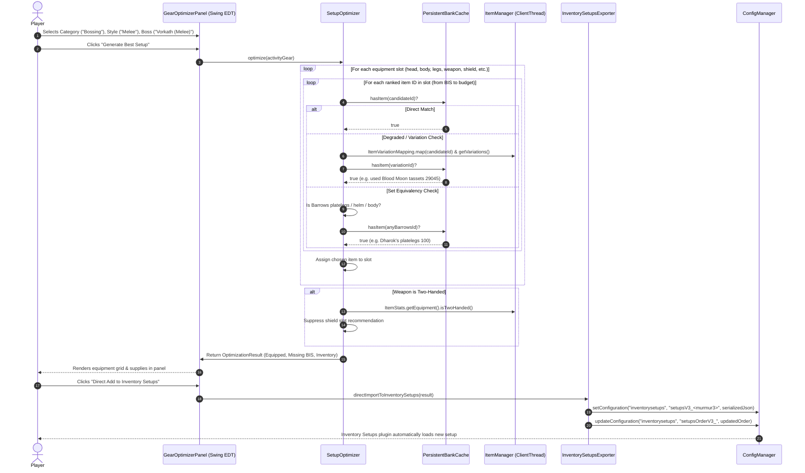

# RuneLite Gear Optimizer

[](https://runelite.net)
[](LICENSE)
[](https://openjdk.org/)
[](https://oldschool.runescape.wiki)

**Gear Optimizer** is a RuneLite plugin that automatically recommends the optimal Best-in-Slot (BIS) gear and inventory supplies for any boss, raid, or slayer task in Old School RuneScape based on items you actually own in your **Bank**, **Inventory**, and **Equipment**, and seamlessly exports them directly into the [Inventory Setups](https://github.com/dillydill123/inventory-setups) plugin.

---

## Table of Contents

- [Key Features](#key-features)
- [Architecture & System Design](#architecture--system-design)
  - [High-Level Architecture](#high-level-architecture)
  - [Component Architecture & Data Flow](#component-architecture--data-flow)
  - [Optimization & Resolution Sequence](#optimization--resolution-sequence)
  - [Threading & Concurrency Model](#threading--concurrency-model)
- [Core Engines](#core-engines)
  - [1. Container Scanning & Persistence](#1-container-scanning--persistence)
  - [2. Variation & Degradation Engine](#2-variation--degradation-engine)
  - [3. Two-Handed Weapon Handling](#3-two-handed-weapon-handling)
  - [4. Inventory Setups Direct Integration](#4-inventory-setups-direct-integration)
- [Database & Content Coverage](#database--content-coverage)
- [User Interface](#user-interface)
- [Configuration Options](#configuration-options)
- [RuneLite Plugin Hub Compliance](#runelite-plugin-hub-compliance)
- [Development & Building](#development--building)

---

## Key Features

- **Local-First & Offline-First:** Ships with an immutable, minified static snapshot of **478 activity setups** scraped directly from the official OSRS Wiki strategy guides. Operates with 0% live web requests during gameplay.
- **Unified Inventory, Equipment, & Bank Tracking:** Checks items worn on your character, held in your backpack, and stored in your bank. If you log in wearing your gear, the plugin detects it instantly without requiring a bank visit.
- **Smart Degradation & Variation Mapping:** Detects degraded items (e.g. used Blood Moon armor, degraded Barrows pieces 100/75/50/25/0, uncharged Dragonfire shields, charged/uncharged blowpipes, corrupted Bowfa) and accurately picks the exact item ID you own.
- **Interchangeable Sets ("Barrows Platelegs"):** Correctly treats interchangeable Wiki recommendations (e.g., "Barrows platelegs" encompassing Torag's, Dharok's, Verac's, and Guthan's tank legs) and selects whatever brother's armor you have.
- **2-Handed Weapon Awareness:** Automatically detects two-handed weapons (e.g. Scythe of Vitur, Bow of Faerdhinen, Twisted Bow, Godswords) and suppresses the shield slot to prevent invalid configurations.
- **Direct Export to Inventory Setups:** Injects setups directly into the Inventory Setups plugin via RuneLite's `ConfigManager` without using reflection, or copies portable JSON to the clipboard.
- **Missing BIS Tracker:** Clearly displays which Best-in-Slot upgrade you are missing for every slot to guide your account progression.

---

## Architecture & System Design

### High-Level Architecture



---

### Component Architecture & Data Flow



---

### Optimization & Resolution Sequence



---

### Threading & Concurrency Model

RuneLite enforces a strict multi-threading architecture. The plugin adheres strictly to these boundaries:

| Operation | Executing Thread | Guardrail / Implementation |
| :--- | :--- | :--- |
| **Container & Game State Scanning** | `ClientThread` | All `client.getItemContainer()` and `itemManager` queries run on the RuneLite client thread or inside `clientThread.invokeLater()`. |
| **Disk & Cache I/O** | `ScheduledExecutorService` | File reads and writes in `PersistentBankCache` run on an asynchronous worker pool, completely decoupled from tick processing. |
| **UI Updates & Rendering** | Swing EDT | All UI label changes, combo-box refreshes, and results panel rendering run inside `SwingUtilities.invokeLater()`. |
| **In-Memory Cache Mutations** | Thread-Safe (`synchronized`) | `cachedBankItemIds` in `PersistentBankCache` uses explicit synchronization locks to prevent concurrent read/write race conditions. |

---

## Core Engines

### 1. Container Scanning & Persistence

Previous bank-only approaches failed when users equipped gear before banking. `GearOptimizerPlugin` unions three live containers:
- `InventoryID.BANK` (when bank booth/chest is open)
- `InventoryID.INVENTORY` (player backpack)
- `InventoryID.EQUIPMENT` (worn equipment)

When bank containers change, the snapshot is asynchronously persisted to `~/.runelite/gear-optimizer/bank_<accountHash>.json` with file permissions restricted to the current OS user. During game ticks when only inventory or equipment changes, updates occur **in-memory only**, resulting in zero disk I/O during active combat.

### 2. Variation & Degradation Engine

RuneLite's native `itemManager.canonicalize()` only resolves placeholders and banknotes—it does **not** map degraded gear. `SetupOptimizer` incorporates a 7-stage resolution hierarchy:

1. **Direct Match:** Exact ID check against owned items.
2. **Canonical Match:** Placeholder/noted normalization.
3. **ItemVariationMapping:** Bi-directional lookup through RuneLite's `ItemVariationMapping.map()` and `getVariations()` (e.g., used Blood Moon chestplate `29043` ↔ clean `29022`, Dragonfire shield uncharged `11284` ↔ charged `11283`).
4. **Blood Moon Armor Group:** Direct support for all clean, used, 0%, and broken states.
5. **Dragonfire / Antifire Shields:** Supports DFS, Dragonfire Ward, and Anti-dragon / Antifire shields (`1540`).
6. **Barrows Interchangeable Sets:** Recognizes all 4 Barrows melee tank legs (Torag's, Dharok's, Verac's, Guthan's), platebodies, and helms across 100/75/50/25/0 tiers.
7. **Slayer Helmet Imbues & Boss Heads:** Maps all imbued variants, recolors, and boss head slayer helms (KBD, Vorkath, Hydra, KQ, Skotizo, Twisted, etc.).

### 3. Two-Handed Weapon Handling

When an optimal two-handed weapon is selected (e.g. Scythe of Vitur, Bow of Faerdhinen, Twisted Bow, Colossal Blade):
- The `shield` slot is automatically cleared from `equippedItems`.
- The `shield` slot is removed from `missingBisItems` so players aren't falsely instructed to bring an off-hand item.

### 4. Inventory Setups Direct Integration

To maintain 100% compliance with RuneLite Plugin Hub policies, `InventorySetupsExporter` avoids Java reflection:
1. Formats an `InventorySetupPortable` object strictly matching `dillydill123/inventory-setups` specifications:
   - 14-element equipment array (`eq`)
   - 28-element inventory array (`inv`)
   - Bank filtering enabled (`fb: true`)
   - Fuzzy variation matching enabled (`f: true`)
2. Writes directly to RuneLite's `ConfigManager`:
   - Config Group: `"inventorysetups"`
   - Key: `"setupsV3_" + murmur3_128(name)`
   - Order Key: `"setupsOrderV3_"`
3. The Inventory Setups plugin automatically receives RuneLite's `ConfigChanged` event and displays the new setup in its overview panel.
4. If configured, also copies the setup JSON to the system clipboard for manual import.

---

## Database & Content Coverage

The bundled database (`src/main/resources/gear_database.json`) contains **478 unique setups**:

```
Total Setups: 478
├── Bossing (378 setups)
│   ├── God Wars Dungeon (Graardor, K'ril, Zilyana, Kree'arra)
│   ├── Desert Treasure II (Vardorvis, Duke Sucellus, The Whisperer, The Leviathan)
│   ├── Dragonkin & Varlamore (Vorkath, Alchemical Hydra, Scurrius, Hueycoatl, Amoxliatl)
│   ├── Wilderness Bosses (Callisto, Venenatis, Vet'ion, Artio, Spindel, Calvar'ion)
│   └── Classic Bosses (Zulrah, Muspah, Cerberus, Corporeal Beast, Nex, DKs, Barrows, etc.)
├── Slayer Tasks (86 setups)
│   ├── High-Tier Tasks (Gargoyles, Abyssal demons, Nechryael, Dust devils, Smoke devils)
│   ├── Dragon Tasks (Rune, Adamant, Mithril, Steel, Iron, Brutal Black, Drakes, Wyrms)
│   ├── Catacombs / Barrage Tasks (Jellies, Ankou, Bloodveld, Greater demons, Hellhounds)
│   └── Specialty Slayer (Kurask, Turoth, Lizardmen Shamans, Basilisks, Vampyres, etc.)
└── Raids (14 setups)
    ├── Chambers of Xeric (Normal & Challenge Mode - Melee, Ranged, Magic)
    ├── Tombs of Amascut (Melee, Ranged, Magic)
    └── Theatre of Blood (Normal, Entry, & Hard Mode - Melee, Ranged, Magic)
```

---

## User Interface

The plugin panel lives in the RuneLite right sidebar:

1. **Bank Status Indicator:** Shows live cache state (e.g. `Bank: 450 items cached`).
2. **Category Filter Dropdown:** Filter between `All Categories`, `Bossing`, `Slayer`, and `Raids`.
3. **Combat Style Filter Dropdown:** Filter between `All Styles`, `Melee`, `Ranged`, and `Magic`.
4. **Target Activity Dropdown:** Alphabetically sorted list of filtered activities.
5. **Generate Best Setup Button:** Runs optimization and populates the results panel.
6. **Equipped Gear Grid:** Visual breakdown showing item icons, names, and slots.
7. **Missing BIS Upgrades Grid:** Displays recommended upgrades for slots where you do not own Best-in-Slot.
8. **Inventory Supplies Grid:** Lists recommended potions, food, and runes, highlighting available vs missing supplies.
9. **Export Buttons:**
   - **Direct Add to Inventory Setups:** Injects the setup into the Inventory Setups plugin.
   - **Copy Setup to Clipboard:** Copies portable JSON to clipboard.
   - **Check Wiki Database Update:** Performs an ETag conditional check against the static repository.

---

## Configuration Options

Accessible in RuneLite under **Configuration → Gear Optimizer**:

| Setting | Default | Description |
| :--- | :--- | :--- |
| **Check for Monthly Updates** | `false` | Automatically checks the static remote repository for database updates every 30 days. Includes standard Plugin Hub IP warning. |
| **Include Inventory Supplies** | `true` | Includes recommended potions, food, and runes in generated setups. |
| **Auto-Copy to Clipboard** | `true` | Automatically copies setup JSON to clipboard when generating setups. |

---

## RuneLite Plugin Hub Compliance

This plugin adheres strictly to the [RuneLite Plugin Hub Guidelines](https://github.com/runelite/plugin-hub):

- [x] **No Automation or Macroing:** Read-only calculations; performs zero simulated clicks, automated prayers, or botting actions.
- [x] **No Reflection on Other Plugins:** Integrates with Inventory Setups entirely via public `ConfigManager` APIs.
- [x] **Network Rules:** All remote network requests default to disabled (`autoSync = false`). When enabled, checks occur at most once every 30 days via HTTP conditional `If-None-Match` (ETag).
- [x] **Zero User Telemetry:** No user-identifying data (usernames, passwords, IP telemetry) is stored or transmitted.
- [x] **Proper Resource Cleanup:** Frees memory, navigation buttons, and container caches in `shutDown()`.
- [x] **Thread Boundaries:** Strict separation of `ClientThread`, `ScheduledExecutorService`, and Swing EDT.
- [x] **Open Source:** Licensed under the permissive **BSD 2-Clause License**.

---

## Development & Building

### Prerequisites

- Java Development Kit (JDK) 11
- Gradle (wrapper provided)

### Build and Test

```powershell
# Clone the repository
git clone https://github.com/jnpike93/gear-optimizer.git
cd runelite-gear-optimizer

# Run unit test suite
.\gradlew.bat test

# Clean build
.\gradlew.bat clean build
```

### Launch in Development Mode

```powershell
.\gradlew.bat run
```

### Re-Scrape Wiki Database

To re-run the live OSRS Wiki scraping worker:

```powershell
node scripts/scrape-wiki-gear.js
```

---

## License

This project is licensed under the BSD 2-Clause License. See the [LICENSE](LICENSE) file for details.